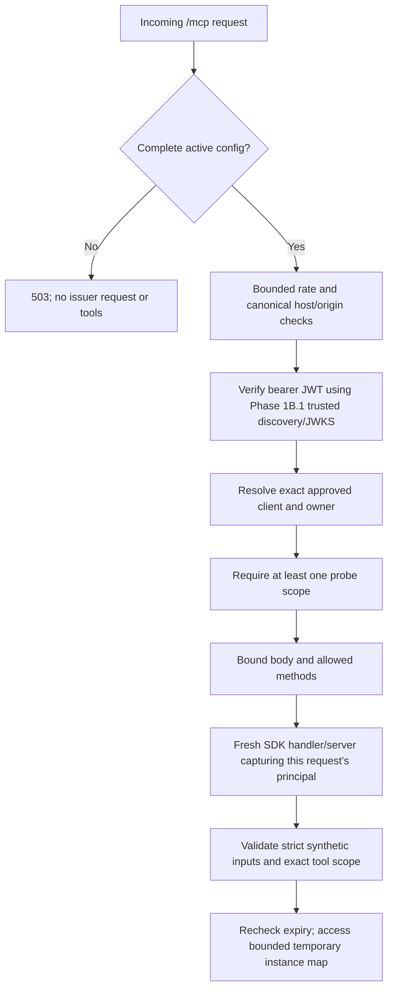

> Historical phase record. Provider/configuration/permission instructions below
> are superseded by [the Supabase integration](supabase-authentication.md).
> Do not configure Auth0 or use the historical environment examples.

# Phase 1B.2: gated authenticated synthetic MCP endpoint

Status: implemented for code review; **not deployed or connected to ChatGPT**.
The default remains 503. No hosted OAuth login, consent, refresh or Vercel
interoperability is claimed by local tests. No Supabase integration exists.

PR #4 was squash-merged into main as
`6a3f384758361691ba658cbad6b4b2f9a8bd4732` after its check passed. This phase
starts from that commit. PR #2 remains unmerged and its reference is unchanged.

## Implementation and cost boundary

The application uses the official **`@modelcontextprotocol/server@2.4.0`** Fetch
handler. The published package's declarations and runtime were inspected and
tested: `createMcpHandler(factory, options).fetch(request, { parsedBody })` builds
a fresh `McpServer` per request. The test client is the matching
`@modelcontextprotocol/client@2.4.0`. The lockfile pins shared core 2.4.0.
No SDK v1 APIs, Express shim, `mcp-handler`, Redis or session registry is used.

The Node App Router route uses `dynamic = 'force-dynamic'` and a 15-second maximum
function duration. No subscriptions, background work, resumability or persistent
server process is needed. The default `auto` response mode avoids intermediate
notifications; this application never emits them. The official SDK's own legacy
fallback uses Streamable HTTP internally; this is v2 package code, not a mixture
of application-level v1 and v2 interfaces.

Additional operating cost must stay **$0 indefinitely**. Only ongoing Vercel
Hobby, Auth0 Free and future Supabase Free entitlements are acceptable. No payment
methods, trials, automatic upgrades, usage billing, paid domains, model APIs or
paid rate-limit/storage services are introduced. Nothing is provisioned here.
Do not attach GitHub deployment automation before separate deployment approval.
Quota exhaustion means rejection/downtime. If free terms change, stop the service
and review a genuinely free alternative; do not upgrade.

## Configuration and activation

No environment values are needed for normal install, build or tests. Missing,
malformed, disabled or expired configuration returns 503
`INTEGRATION_NOT_CONFIGURED` from both MCP and resource metadata routes. There
is no anonymous mode and no synthetic owner fallback. No environment file with
hosted values should be created as part of this PR.

All [Phase 1B.1 server variables](phase-1b1-authentication.md#server-configuration-contract-do-not-configure-hosted-values-yet)
remain required: issuer, canonical `/mcp` audience, approved client ID, exact owner
subject and explicit internal owner UUID. Two additional server-only values are
mandatory for activation:

| Variable | Contract |
| --- | --- |
| `MCP_EXPERIMENT_ENABLED` | Exactly `true`; every other value is disabled |
| `MCP_EXPERIMENT_EXPIRES_AT` | ISO 8601 instant with UTC/offset, strictly in the future and no more than 24h away |

The expiry is fixed, never automatically extended. Authorization and tool
callbacks recheck the deadline. The gateway revalidates configuration for every
request; removal/invalidity discards its cached experiment. Any valid change to
issuer, audience, owner, client or expiry starts a new isolated instance and loses
its temporary data. A disabled flag is not an alternative to validating OAuth
when enabled. `NEXT_PUBLIC_` variants of authentication/experiment settings fail
validation. No issuer requests or configuration reads occur on module import.

The future canonical audience should be the stable free provider URL, for example
`https://PROJECT.vercel.app/mcp`, not a preview URL. The actual URL and any hosted
values require later approval. The resource server needs no OAuth client secret,
refresh token, private signing key or Supabase service credential.

## Request and identity boundary



The [Phase 1B.1 verifier](phase-1b1-authentication.md) remains responsible for exact
issuer/resource audience, RS256 signature, RFC 9068 `at+jwt` type, approved
`client_id`, required timestamps/claims, token lifetime and scope parsing.
Owner identity comes only from a verified issuer/subject binding. Cookies,
query parameters, tool arguments, forwarded hosts, MCP `_meta`, clientInfo and
caller-provided authInfo cannot establish identity.

Every HTTP request authenticates again, including initialization and tool
discovery. A token needs at least one of `tracker:read` or `entries:write` to
enter the experiment; each tool additionally enforces its own scope. A verified
principal is captured only by that request's fresh server factory. Neither
tokens nor principals are kept in the shared probe map. Concurrent calls do not
inherit another caller's owner/scopes.

Request-level failures use the existing sanitized `WWW-Authenticate` helper:
401 for missing/invalid/expired credentials; 403 for an unapproved owner/client or
no probe scopes; 503 for verifier availability failures. Insufficient scope
within a tool call returns an MCP `isError` result and
`_meta["mcp/www_authenticate"]` with the required scope. Its HTTP status is 200
because it is a tool result. ChatGPT may use this to request consent again.
No token, subject, internal UUID or private configuration appears in probe output.

## Metadata, methods and bounds

`GET /.well-known/oauth-protected-resource/mcp` publishes RFC 9728 resource
metadata, with a root well-known alias for client convenience. It contains only
the configured canonical resource, authorization server issuer, supported probe
scopes, header bearer method and a generic name. It is public when active,
`no-store`, and permits cross-origin public metadata GETs without credentials.
The protected tools remain authenticated. This is resource metadata, not a
custom authorization server, login endpoint or Auth0 discovery proxy.

The canonical `/mcp` URL origin and any Host header must match configuration.
Origin, if present, must equal that same origin; absent Origin is allowed for
server clients. Forwarded headers are never used to construct challenges or
metadata. MCP responses do not enable browser cross-origin credential access.
Inspector/browser clients must use a compatible proxy; do not bypass these
checks by adding wildcard authenticated CORS or localhost production exceptions.

The endpoint accepts POSTs for initialization, initialized notification, ping,
modern discovery, tool discovery and tool calls. Authenticated GET/DELETE receive
405; anonymous ones still receive 401. Sessions, subscriptions, legacy HTTP+SSE
endpoints and JSON-RPC batches are unsupported. Other methods are rejected.
Bodies are bounded to **16 KiB** using the official SDK reader before dispatch.
Tool input elements are additionally bounded. Non-JSON content types fail 415.

A constant-size counter limits each runtime instance to **120 MCP requests per
minute**, including anonymous requests. Further calls return 429 with Retry-After.
This is not a distributed abuse defense: cold starts/scaling reset the counter.
Trusted-key requests retain Phase 1B.1's limits/cache/coalescing. A slow caller can
still consume a function invocation until the platform's duration bound; Hobby
quota exhaustion is an accepted outage risk, not justification for paid capacity.
No application logging of credentials, arguments or records is added.

## Synthetic tools and explicitly non-durable state

| Tool | Scope | Inputs and behavior |
| --- | --- | --- |
| `read_probe` | `tracker:read` | Exact slot `synthetic-1` through `synthetic-10`; returns found status, instance ID and any temporary record |
| `write_probe` | `entries:write` | Same slot, UUID operationKey, value exactly `alpha`, `beta` or `gamma`; creates a record and generated receipt |

Strict Zod objects reject extra fields, including acting user IDs and receipts.
No arbitrary notes, numeric measurements, food, exercise or health data is accepted.
OAuth requirements are advertised in each tool's `_meta.securitySchemes`.
`read_probe` is read-only. `write_probe` has **`readOnlyHint: false`** and is
described as a mutation. It creates only; it cannot overwrite an occupied slot.
Its `idempotentHint` is conservatively false because its replay guarantee is
temporary. There is no custom application confirmation screen, and platform
write/consent prompts must be honored. Never relabel the tool to bypass them.

One module/runtime experiment shares a map of at most **10 records**, not one
map per MCP session. Each record includes the operation key, slot/value, generated
UUID receipt, creation instant and expiry. Every response includes `instanceId`,
`durable: false` and `storage: temporary-instance-memory`. Records expire after
**10 minutes or the experiment deadline**, whichever comes first. Cleanup is
lazy on use; this is not a secure-erasure guarantee and real data is forbidden.

An identical live operation key/payload returns `replayed` with the same receipt.
Reusing a key with a different payload returns `IDEMPOTENCY_CONFLICT`. A new key
for an occupied slot returns `SLOT_OCCUPIED`; existing receipts are never silently
evicted to make room. Expiry, process restart, config changes or another Vercel
instance can lose all records/replay history. After that, the same operation key
may create a new receipt. This proves neither durable idempotency nor database
persistence. Later production logging must use PostgreSQL transactions and
durable operation records, not this store.

## Protocol findings for the pinned package

| Protocol | Local evidence |
| --- | --- |
| `2026-07-28` | SDK v2 auto-negotiating client chooses modern era; `server/discover`, tool discovery, read and write succeed; responses are JSON |
| `2025-11-25` | Initialization negotiates the requested revision; discovery and write succeed via stateless finite SSE |
| `2025-06-18` | Same initialization/discovery/execution checks pass |
| `2025-03-26` | Same initialization/discovery/execution checks pass |
| Other HTTP protocol headers | Rejected; modern header/envelope mismatches and missing envelopes also fail |

The official v2 client is tested in both legacy and auto modes. No MCP session ID
is issued. `responseMode` affects the modern path only in 2.4.0; the official
legacy fallback returns finite SSE and tears down when the result stream ends.
Do not claim JSON-only serving across both eras or add a v1 transport to change it.
Streaming and cold starts on actual Vercel Hobby remain to be verified.

Relevant upstream references: the [official SDK HTTP guide](https://github.com/modelcontextprotocol/typescript-sdk/blob/main/docs/serving/http.md),
[protocol-era documentation](https://github.com/modelcontextprotocol/typescript-sdk/blob/main/docs/protocol-versions.md),
and [OpenAI authentication requirements](https://developers.openai.com/plugins/build/auth).
The tests exercise the pinned published package, not an assumption that upstream
main documentation applies to every release. ChatGPT's actual negotiated revision
is unknown until an approved hosted test; SDK-client success does not prove it.

## Automated verification

```sh
pnpm install --frozen-lockfile
pnpm exec playwright install chromium
pnpm check
pnpm audit --audit-level=low
```

Use `PLAYWRIGHT_CHROMIUM_EXECUTABLE_PATH=/usr/bin/chromium pnpm check` for an
existing compatible Linux Chromium. CI installs its browser and runs the same
suite with read-only GitHub permissions, no credentials and no deployment job.
Unit/integration fixtures generate local RSA keys, use synthetic claims and
intercept issuer fetches; no hosted account or token is needed. Tests cover the
actual App Router exports as well as the reusable Fetch gateway.

Coverage includes activation/config removal/deadline, metadata, initialization,
discovery, both protocol eras, scope challenges, invalid/wrong-audience/expired
tokens, forged owners/arguments, concurrency isolation, rate/body/origin/method
bounds, replay/conflicts/capacity/TTL/restart and public bundle isolation.
The production bundle scan uses synthetic secret canaries. Browser tests start
the built Next.js app with the experiment explicitly disabled and assert 503
for anonymous/synthetic bearer calls and both metadata routes. They also verify
the existing dashboard shell. No trace containing credentials is recorded.

## Manual hosted acceptance runbook — requires separate approval

Do not execute hosted setup, deploy, configure production credentials or connect
ChatGPT while reviewing this PR. The following is a future checklist, not a claim
of completed work or permission to create accounts.

1. **Free-plan gate:** verify Vercel Hobby eligibility and every required Auth0
   ongoing Free capability in [ADR 002](phase-1b1-authentication.md#planned-auth0-configuration-and-ongoing-free-eligibility-gate),
   outside any trial. Do not supply a card or accept an upgrade/add-on. Stop and
   document a blocker if non-trial access to a required control is unavailable.
2. **OAuth configuration:** use one strict pre-registered third-party client,
   authorization-code plus mandatory S256, explicit delegated API grant and
   both probe scopes. Set the canonical API identifier, RS256 RFC 9068 profile
   and 300s access tokens. Verify resource compatibility, callback issuer
   identification, offline access, rotating/bounded refresh and exact discovery
   values as documented in ADR 002. Do not use a permissive client as a fallback.
3. **Private owner binding:** deliberately choose the sole owner subject and
   internal UUID. Store them only in approved server environment settings, with
   issuer, audience and client ID. The client secret belongs only in Auth0 and
   ChatGPT/Inspector client configuration. Do not paste tokens into repository
   files, issue comments, terminal arguments, screenshots or this public PR.
4. **Separately approved deployment:** deploy only the reviewed commit to Hobby
   using a stable provider hostname. No paid domain, storage, Redis or model API.
   Initially leave the experiment disabled: `/mcp` and both metadata URLs must
   return uncached 503 and make no issuer calls. Check previews cannot expose
   an active experiment under another origin.
5. **Short activation:** after separate testing authorization, set the flag to
   `true` and a fixed one-hour UTC expiry. A suitable deadline can be calculated
   locally with `node -e 'console.log(new Date(Date.now()+3600000).toISOString())'`.
   Do not automate renewal. Verify the two metadata URLs return the exact same
   canonical document without owner IDs/secrets. Anonymous `/mcp` must return
   401 with the canonical metadata challenge; expired/invalid config must be 503.
6. **MCP Inspector:** use the official Inspector with a version supporting the
   selected protocol, through its local proxy. The reviewed Inspector 2.14.0
   depends on SDK 2.4.0. After separate hosted-testing approval, start it locally
   from a directory outside this repository with a fresh metadata directory and
   memory-only secrets (Node 24.22.1 or a supported newer patched version):

   ```sh
   probe_inspector_dir="$(mktemp -d)"
   MCP_STORAGE_DIR="$probe_inspector_dir" MCP_INSPECTOR_SECRET_STORE=memory pnpm dlx @modelcontextprotocol/inspector@2.14.0
   ```

   See the [official Inspector guide](https://github.com/modelcontextprotocol/inspector)
   and [secret storage documentation](https://github.com/modelcontextprotocol/inspector/blob/main/docs/secret-storage.md).
   Keep its local API authentication enabled. Use OAuth settings rather than a
   saved Authorization header (headers may be persisted in config files).
   Select Streamable HTTP at the
   canonical `/mcp` URL. Configure the approved pre-registered client and exact
   Inspector callback in Auth0 for this temporary test; keep its client grant
   restricted. Complete OAuth and inspect initialize/discovery/annotations.
   Do not inject a production token through URLs or disable host/origin checks.
   Ensure auth-invalid, missing-scope and wrong-owner attempts cannot execute.
   Remove any temporary Inspector callback when finished, stop Inspector and
   delete that specific temporary metadata directory. No Inspector server was
   started as part of implementing this PR.
7. **ChatGPT connection:** copy the exact callback from its management UI into
   the Auth0 allowlist; do not guess a callback. Provide the pre-registered client
   configuration in ChatGPT, complete owner login and explicit scope consent,
   and verify discovery/S256/resource/issuer behavior. Record only sanitized
   status codes and negotiated protocol, never codes, tokens, subjects or secrets.
8. **Synthetic read/write:** ask ChatGPT to call `read_probe` for `synthetic-1`:
   expect `found:false` on the current instance. Ask it to write `alpha` with a
   newly generated UUID operation key. Honor every platform write confirmation.
   Expect `created`, a generated receipt, `durable:false` and an instance ID.
   Repeat exactly: expect `replayed` and the same receipt **if the instance and
   record are still live**. Read back from the same and a new conversation.
9. **Isolation and limits:** a read-only token must fail a write with the tool
   scope challenge; a write-only token cannot read. Unapproved owner/client,
   wrong-audience/expired token and userId arguments must never produce a write.
   Prefer the local generated-token test suite for destructive token variants;
   do not export production tokens to public debugging tools.
10. **Refresh, cold starts and expiry:** verify a fresh conversation still
    authenticates, refresh preserves audience/client/scope binding, and rotation
    works without weakening settings. Test cold-start streaming/timeout behavior.
    After a restart or ten minutes, loss of data is expected; a changed instance
    ID is evidence of instance loss, not an OAuth failure. At the activation
    deadline both metadata and MCP must be 503. Record actual behavior separately
    from local test results. No durable persistence acceptance is part of this phase.

Success requires actual owner ChatGPT login, verified authenticated read/write,
truthful platform permissions, negative authorization cases, refresh behavior,
bounded serverless responses and automatic deadline shutdown on ongoing free
plans. If any of these fail, disable, document the specific blocker and stop;
do not purchase capacity or weaken authentication to make the experiment pass.

## Rollback, cleanup and outstanding risks

For a later hosted test, disable the flag first on every active deployment;
remove unneeded public deployment URLs and revoke the OAuth connection/refresh
grant through the provider. Existing access tokens may remain valid until their
short expiry, so verify the disabled endpoint rejects new requests. In-flight
requests are bounded by the function duration. Resetting/changing configuration
loses all temporary receipts by design. Remove temporary callbacks, settings and
client grants when the experiment ends. Never enable a paid cleanup/backup service.

Code rollback is a reviewed revert to the Phase 1B.1 disabled route; this PR is
not automatically merged or deployed. No infrastructure or database data needs
rollback now. The public reference under `references/phase0` remains untouched.

Outstanding risks are live OAuth/Free entitlement incompatibility, cold-start
latency, finite SSE behavior behind the host, host/origin normalization, quotas,
per-instance rate limits and temporary replay/data loss. JWT validation cannot
instantly learn provider-side revocation; bearer theft remains usable until
expiry while the experiment is active. No logs should retain credentials or
personal data. Security tests do not establish a production SLA, dashboard login,
PostgreSQL RLS, durable idempotency or future tracker readiness.
